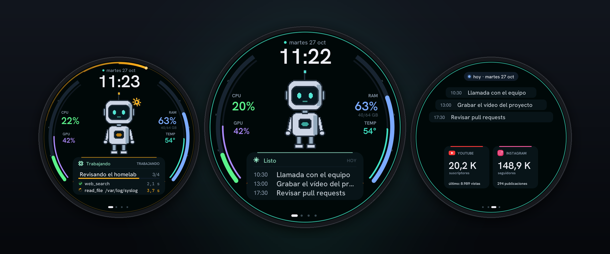
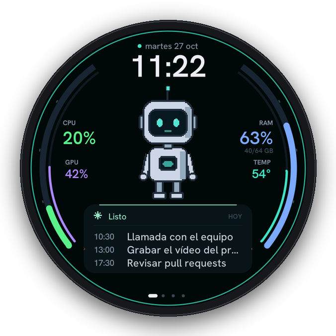
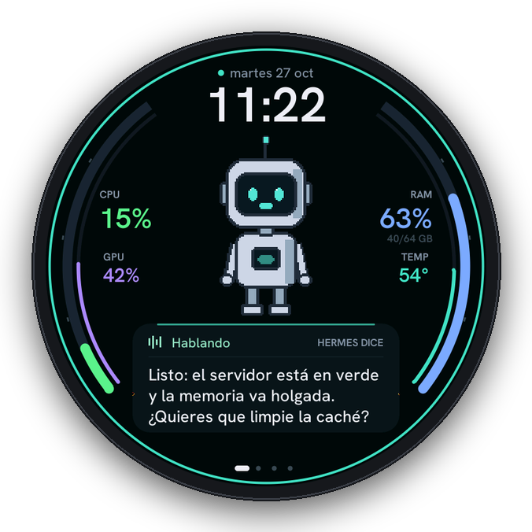
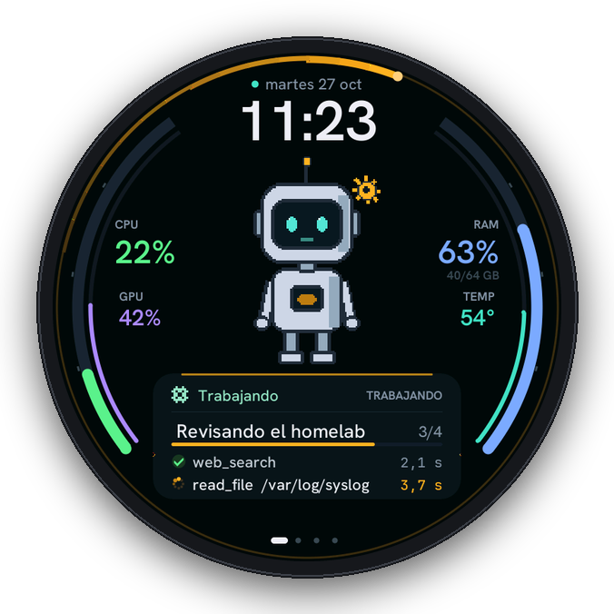
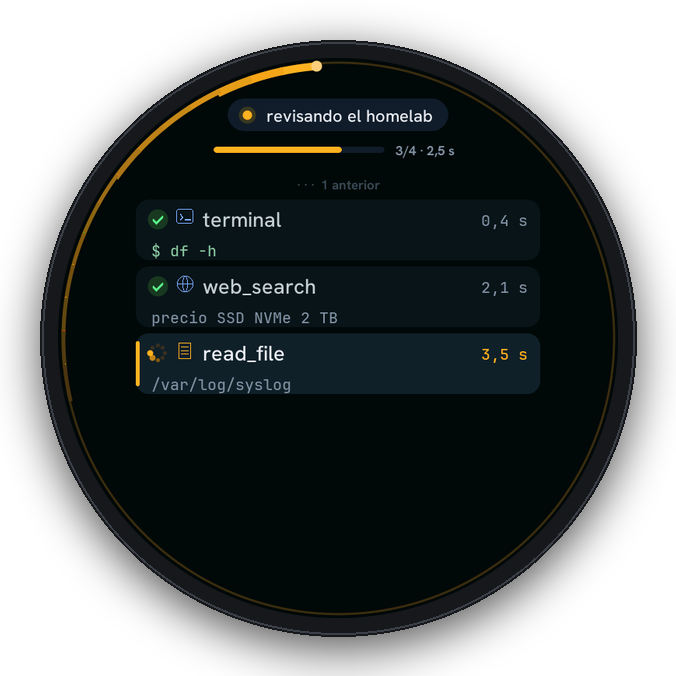
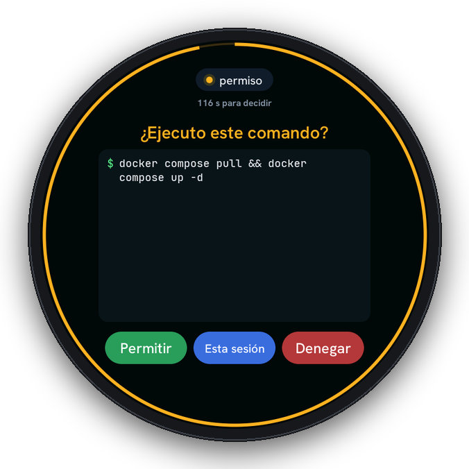
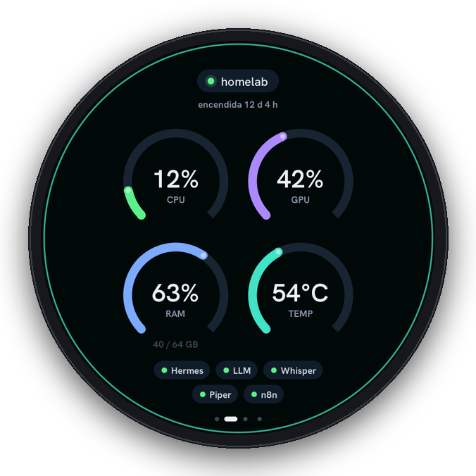
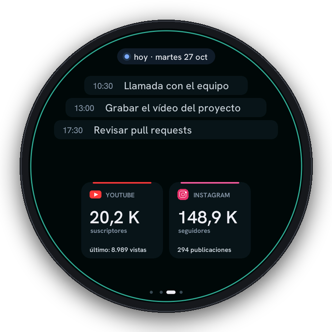
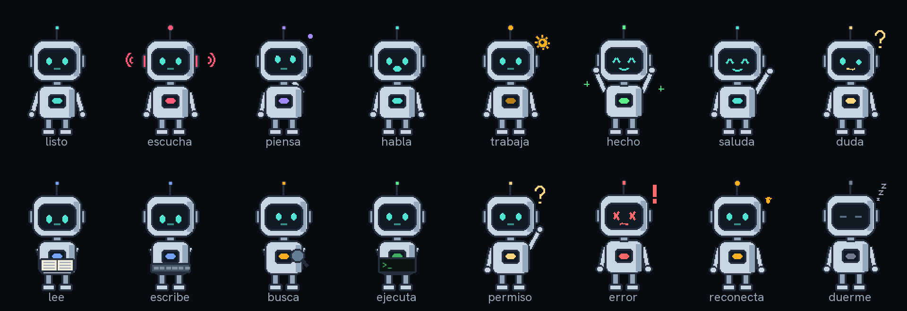
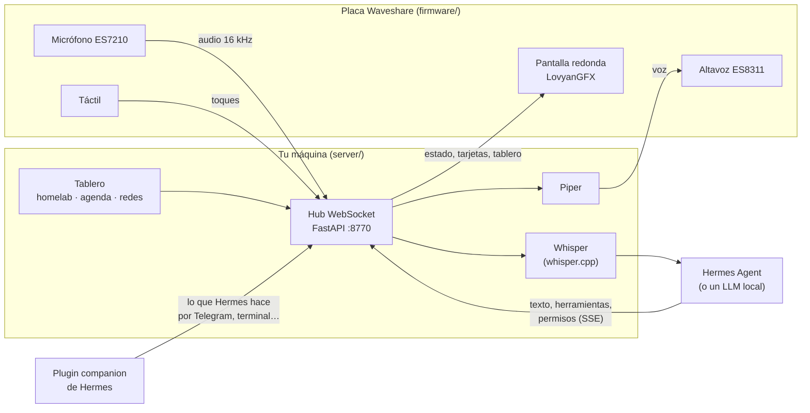

<div align="center">

# Pana

**La cara y la voz de tu agente de IA, en una pantalla redonda de Waveshare.**

Mantén pulsado el personaje, habla, y tu agente ([Hermes Agent](https://github.com/NousResearch/hermes-agent) o cualquier LLM compatible con OpenAI) te contesta en voz alta mientras ves en la pantalla lo que está haciendo: qué herramienta usa, cuánto tarda y qué te pide confirmar.

[](LICENSE)
[](firmware/platformio.ini)
[](#placas-compatibles)
[](server/requirements.txt)
[](#personalízalo-con-claude-code)



</div>

---

## Qué es

Pana tiene dos partes:

- **El cuerpo** (`firmware/`): una placa ESP32 con pantalla táctil, micrófono y altavoz. Es «tonta» a propósito: pinta, anima, escucha y reproduce. Nada de lógica de negocio.
- **El cerebro** (`server/`): un servidor en Python que corre en tu ordenador o en tu homelab. Recibe tu voz, la transcribe con Whisper, se la pasa a tu agente, convierte la respuesta en voz con Piper y le dice a la placa qué mostrar.

Entre los dos hablan un protocolo sencillo por WebSocket ([`protocol/PROTOCOL.md`](protocol/PROTOCOL.md)). Varias placas pueden estar conectadas a la vez al mismo cerebro.

**Lo que ves en la pantalla**

- 🗣️ **Push-to-talk:** mantén pulsado el personaje (o el botón BOOT), habla y suelta. Suena un chirrido al empezar y otro al terminar.
- 🛠️ **El agente trabajando, en vivo:** cada herramienta que usa Hermes, con su detalle (`df -h`, la búsqueda, la ruta…), su estado y su tiempo.
- ✋ **Confirmaciones:** nada externo se ejecuta sin que toques *Permitir*. Si caduca, se cancela.
- 📊 **Tu homelab:** CPU, GPU, RAM y temperatura en los arcos del borde, y el estado de tus servicios.
- 📅 **Tu día:** la agenda (cualquier calendario con dirección iCal), y tus cifras de YouTube e Instagram.
- 🧠 **Tu grafo de Obsidian**, para tocar notas y ver sus conexiones.
- 🌙 **Duerme solo:** baja el brillo a los 45 s y se apaga a los 2 min; vuelve al tocarla.

## Placas compatibles

Todas son de **Waveshare**. El proyecto nació con su apoyo y la idea es cubrir cada vez más modelos.

| Placa | Pantalla | Estado | Dónde comprarla |
|---|---|---|---|
| **ESP32-S3-Touch-AMOLED-1.75** / **1.75C** | AMOLED redonda 1,75″ · 466×466 · CO5300 | ✅ Soportada (`amoled175`) | [Waveshare](https://www.waveshare.com/esp32-s3-touch-amoled-1.75c.htm?sku=33691) · [Amazon](https://link.amazon/B07MvbpFL) |
| **ESP32-P4-WIFI6-Touch-LCD-4C** | IPS redonda 4″ · 720×720 · MIPI-DSI | ✅ Soportada (`p4-4c`), interfaz completa con tablero | [Waveshare](https://www.waveshare.com/esp32-p4-wifi6-touch-lcd-3.4c.htm?sku=31522) · [Amazon](https://link.amazon/B0ezg9Zsc) |
| ESP32-S3-Touch-LCD-1.85C | LCD redonda 1,85″ · 360×360 | 🔜 En camino | [Waveshare](https://www.waveshare.com/esp32-s3-touch-lcd-1.85c.htm?sku=30683) · [Amazon](https://link.amazon/B0bORP7J7) |
| ESP32-S3-Touch-AMOLED-2.06 | AMOLED 2,06″ (reloj) · 410×502 | 🔜 En camino | [Waveshare](https://www.waveshare.com/esp32-s3-touch-amoled-2.06.htm?sku=31957) · [Amazon](https://link.amazon/B09RK0t7h) |
| ESP32-P4-WIFI6-Touch-LCD-3.5 | IPS 3,5″ · 320×480 · cámara | 🔜 En camino | [Waveshare](https://www.waveshare.com/esp32-p4-wifi6-touch-lcd-3.5.htm?sku=33360) · [Amazon](https://link.amazon/B0f503CEz) |

<sub>Los enlaces de Amazon son de afiliado: si compras por ellos, el proyecto recibe una pequeña comisión sin que te cueste más.</sub>

¿Tienes otra placa de Waveshare? Lee [cómo añadir una placa](docs/hardware.md#añadir-una-placa) o pídeselo a Claude con la skill incluida.

## Así se ve

<table>
<tr>
<td align="center" width="33%"><br><b>En reposo</b><br><sub>Hora, homelab en los arcos y la agenda debajo</sub></td>
<td align="center" width="33%"><br><b>Habla</b><br><sub>El texto se escribe mientras suena la voz</sub></td>
<td align="center" width="33%"><br><b>Trabaja</b><br><sub>Las herramientas del agente, con su progreso</sub></td>
</tr>
<tr>
<td align="center"><br><b>Consola</b><br><sub>Toca el panel para verlo todo</sub></td>
<td align="center"><br><b>Pide permiso</b><br><sub>Con la cuenta atrás en el anillo</sub></td>
<td align="center"><br><b>Homelab</b><br><sub>CPU, GPU, RAM, temperatura y servicios</sub></td>
</tr>
<tr>
<td align="center"><br><b>Hoy</b><br><sub>Agenda, YouTube e Instagram</sub></td>
<td colspan="2" valign="middle"><sub>Capturas reales de la ESP32-P4 4C (720×720), sacadas de la propia placa con <code>tools/shot.py</code>. En la AMOLED 1.75 la interfaz es la misma idea en 466×466, con páginas: personaje, consola y grafo.</sub></td>
</tr>
</table>

## El personaje

Viene con **Pana**, un robot en pixel art con 16 estados que el servidor elige según lo que pasa: escucha, piensa, habla, busca, lee, ejecuta, pide permiso, se alegra, duerme…



Es solo un ejemplo: **ponle tu propia cara**. Dibuja (o genera) tus cuadros de 120×160 con transparencia, nómbralos `<estado>-000.png`, `<estado>-001.png`… y conviértelos:

```bash
python tools/make_avatar.py mi-avatar/      # escribe firmware/src/character/sprites43.h y sprites_data43.cpp
```

El robot de ejemplo se dibuja por código en [`tools/demo_avatar.py`](tools/demo_avatar.py): cámbiale los colores en dos líneas, o úsalo de plantilla.

## Cómo funciona



## Empezar

Necesitas: una placa compatible, un cable USB-C de datos, [PlatformIO](https://platformio.org/install), Python 3.11+ y una máquina en tu red que haga de cerebro (Linux o macOS).

### 1 · El cerebro

```bash
git clone https://github.com/eriktaveras/pana-companion && cd pana-companion
python3 -m venv .venv && source .venv/bin/activate
pip install -r server/requirements.txt
cp .env.example .env          # y ajústalo (tu zona horaria, tu nombre, dónde está tu agente…)
```

- **Voz a texto:** levanta un [whisper.cpp server](https://github.com/ggml-org/whisper.cpp/tree/master/examples/server) en `:8771` (`STT_URL`).
- **Texto a voz:** descarga una voz de [Piper](https://github.com/rhasspy/piper/blob/master/VOICES.md) en `server/voices/` (por ejemplo `es_MX-claude-high.onnx` y su `.json`) y ponla en `PIPER_MODEL`.
- **El agente:** con [Hermes Agent](https://github.com/NousResearch/hermes-agent), activa su API server (compatible con OpenAI, `:8642`) y guarda su clave en el archivo de `HERMES_API_KEY_FILE`. Sin Hermes, pon `COMPANION_BRAIN=local` y apunta `LLM_CHAT_URL` a tu llama.cpp, Ollama o LM Studio.

```bash
cd server && python main.py           # http://localhost:8770 abre un simulador web de la placa
```

Para dejarlo como servicio hay un ejemplo de systemd en [`deploy/pana.service`](deploy/pana.service).

### 2 · El cuerpo

```bash
cd firmware
pio run -e amoled175 -t upload        # ESP32-S3-Touch-AMOLED-1.75 / 1.75C
pio run -e p4-4c && ../tools/flash_p4.sh   # ESP32-P4-WIFI6-Touch-LCD-4C (ver nota)
```

> **ESP32-P4:** el esptool de PlatformIO se cuelga con el P4 revisión 3. `tools/flash_p4.sh` graba con el de [ESP-IDF](https://docs.espressif.com/projects/esp-idf/en/latest/esp32p4/get-started/) (5.5 o superior).

### 3 · Primer arranque

La placa abre una red Wi-Fi llamada **`Pana-Setup`**. Conéctate desde el móvil, elige tu Wi-Fi y escribe la IP de la máquina del cerebro. Listo: el personaje te saluda.

(Si prefieres no usar el portal, copia `firmware/include/secrets.example.h` a `secrets.h` con tus datos antes de compilar. Está en `.gitignore`.)

### 4 · Ver lo que Hermes hace en otros canales (opcional)

Copia [`hermes-plugin/companion`](hermes-plugin/companion) a `~/.hermes/plugins/` y reinicia Hermes. Lo que le pidas por Telegram, la terminal o el dashboard también aparecerá en la pantalla.

## Personalízalo con Claude Code

El repositorio trae una skill, **[`personalizar-pana`](.claude/skills/personalizar-pana/SKILL.md)**, que le explica a Claude cómo está hecho el proyecto y dónde tocar cada cosa. Abre [Claude Code](https://claude.com/claude-code) en la carpeta del repo y pide lo que quieras:

> *«Cambia el personaje por un gato naranja»*
> *«Pon la interfaz en tonos morados y la hora más grande»*
> *«Añade un widget con el precio del bitcoin en la página de hoy»*
> *«Haz que hable con acento argentino y se llame Che»*
> *«Adapta Pana a mi Waveshare ESP32-S3-Touch-LCD-1.85C»*

La skill cubre el avatar, colores y diseño de cada pantalla, la persona y la voz, nuevos datos en el tablero, nuevas placas y cómo compilar, grabar y comprobar con capturas de la propia placa.

## Estructura

```
firmware/            el cuerpo (PlatformIO, Arduino-ESP32 3.x + LovyanGFX)
  include/board.h      pines y pantalla de cada placa
  src/ui/ui720.cpp     interfaz de la P4 4C (720×720)
  src/ui/ui175.cpp     interfaz de la AMOLED 1.75 (466×466)
  src/character/       el avatar (generado por tools/make_avatar.py)
server/              el cerebro (FastAPI)
  brain/               conversación, Hermes, persona, ánimo, memoria, tablero
  voice/               Whisper y Piper
  sim/                 simulador web de la placa
protocol/PROTOCOL.md el contrato entre cuerpo y cerebro
hermes-plugin/       plugin para que Hermes avise a la placa desde cualquier canal
tools/               avatar, fuentes, capturas de pantalla, grabado de la P4
.claude/skills/      la skill para personalizarlo con Claude
```

## Comandos por el puerto serie

Abre el monitor a 115200 (`pio device monitor`) y escribe:

| Comando | Qué hace |
|---|---|
| `s` | Captura de pantalla (`python tools/shot.py <puerto> salida.png 2`) |
| `g` · `e` | Página siguiente · abrir o cerrar la consola |
| `v` | Push-to-talk sin tocar la pantalla |
| `b` · `m` | Pitido · prueba del micrófono (nivel por canal) |
| `x` | Congelar la pantalla (diagnóstico) |
| `P` | Carta de ajuste (P4) |
| `host <ip>` · `port <n>` | Cambiar el servidor (se guarda; reinicia para aplicar) |
| `wifi reset` · `info` | Olvidar la Wi-Fi y abrir el portal · versión y memoria |

## Problemas conocidos

- **AMOLED 1.75, el táctil no responde:** el CST9217 a veces se queda colgado y solo vuelve quitándole la corriente del todo (USB fuera y botón PWR unos segundos).
- **AMOLED 1.75, el micrófono da silencio:** el ES7210 necesita el MCLK también por GPIO16; el firmware ya lo hace.
- **P4 4C, el fondo «palpita»:** el CABC del panel (brillo adaptativo) estaba activo; el firmware lo apaga al arrancar. Si lo ves, prueba otra alimentación USB.
- **P4 4C, rayas o parpadeo al animar:** la pantalla lee de la misma PSRAM en la que se pinta; por eso solo se copia lo que cambia. Si añades animaciones grandes, mira [docs/hardware.md](docs/hardware.md#p4-memoria-y-pantalla).

## Créditos

- Placas y apoyo: **[Waveshare](https://www.waveshare.com)**.
- Gráficos: [LovyanGFX](https://github.com/lovyan03/LovyanGFX) (FreeBSD). Configuración de pantallas a partir de los BSP oficiales de Waveshare.
- Fuentes: [Hanken Grotesk](https://github.com/marcologous/hanken-grotesk) y [JetBrains Mono](https://github.com/JetBrains/JetBrainsMono) (SIL OFL 1.1).
- Voz: [whisper.cpp](https://github.com/ggml-org/whisper.cpp) y [Piper](https://github.com/rhasspy/piper). Agente: [Hermes Agent](https://github.com/NousResearch/hermes-agent).

Detalle de licencias de terceros en [THIRD_PARTY.md](THIRD_PARTY.md). El código de este repositorio es **MIT**.

---

<details>
<summary><b>English</b></summary>

**Pana** gives your AI agent a face and a voice on a round Waveshare touchscreen. Hold the character, talk, and your agent ([Hermes Agent](https://github.com/NousResearch/hermes-agent) or any OpenAI-compatible LLM) answers out loud while the screen shows what it is doing: which tool it runs, how long it takes, and what it needs you to approve.

- **Body** (`firmware/`): an ESP32-S3 or ESP32-P4 board with display, mic and speaker. Draws, animates, listens and plays audio.
- **Brain** (`server/`): a Python/FastAPI server on your machine. Whisper for speech-to-text, Piper for text-to-speech, your agent in the middle, a WebSocket protocol to the boards.
- **Supported boards:** Waveshare ESP32-S3-Touch-AMOLED-1.75/1.75C and ESP32-P4-WIFI6-Touch-LCD-4C. More Waveshare boards are on the way.
- **Customize it with Claude Code:** the repo ships a skill (`.claude/skills/personalizar-pana`) so you can ask Claude to change the character, the colors, the persona, add dashboard widgets or port it to a new board.

The UI and docs are in Spanish; the code is commented in Spanish too. Quick start: `cp .env.example .env`, `pip install -r server/requirements.txt`, `python server/main.py`, then `pio run -e amoled175 -t upload` (or `p4-4c` + `tools/flash_p4.sh`), and join the `Pana-Setup` Wi-Fi from your phone. MIT licensed.

</details>
